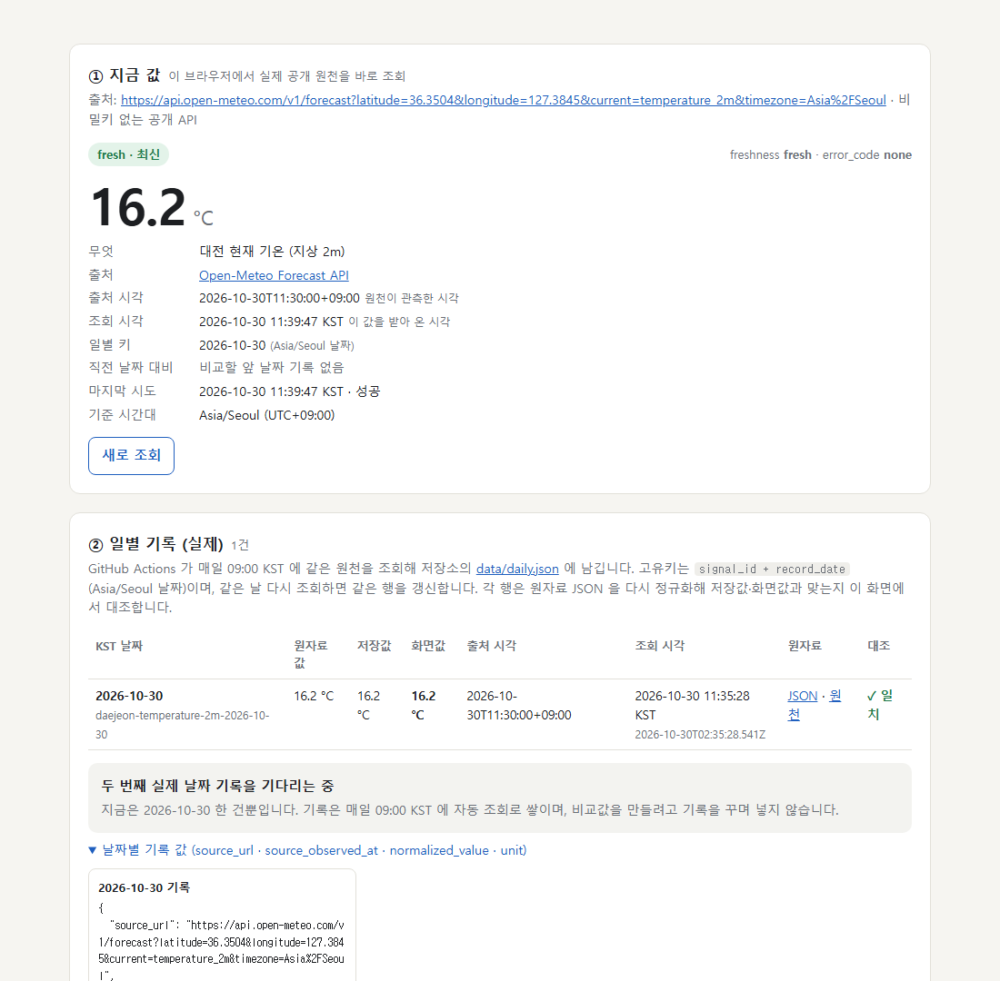
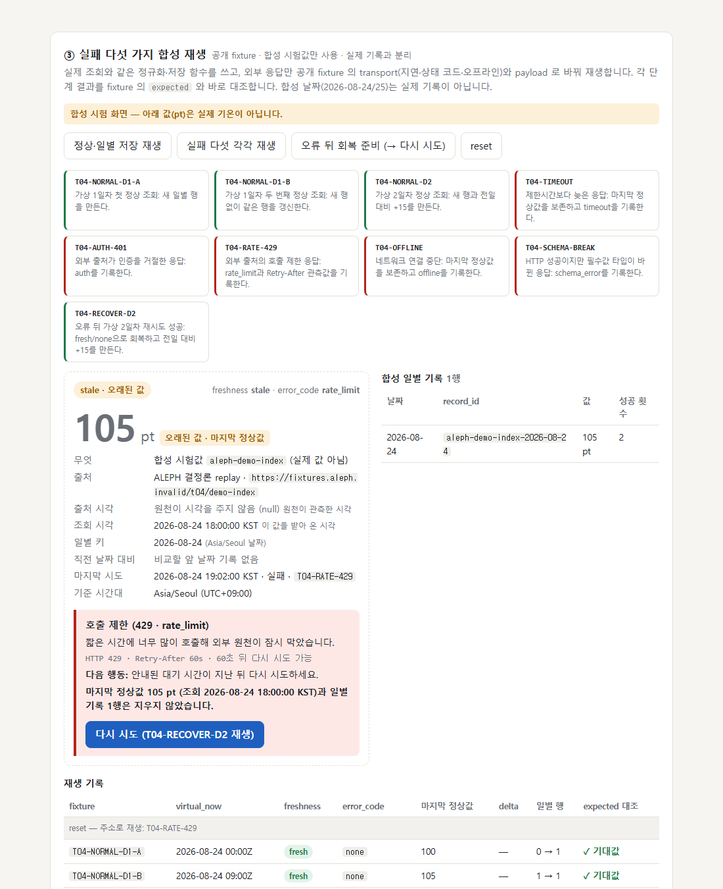
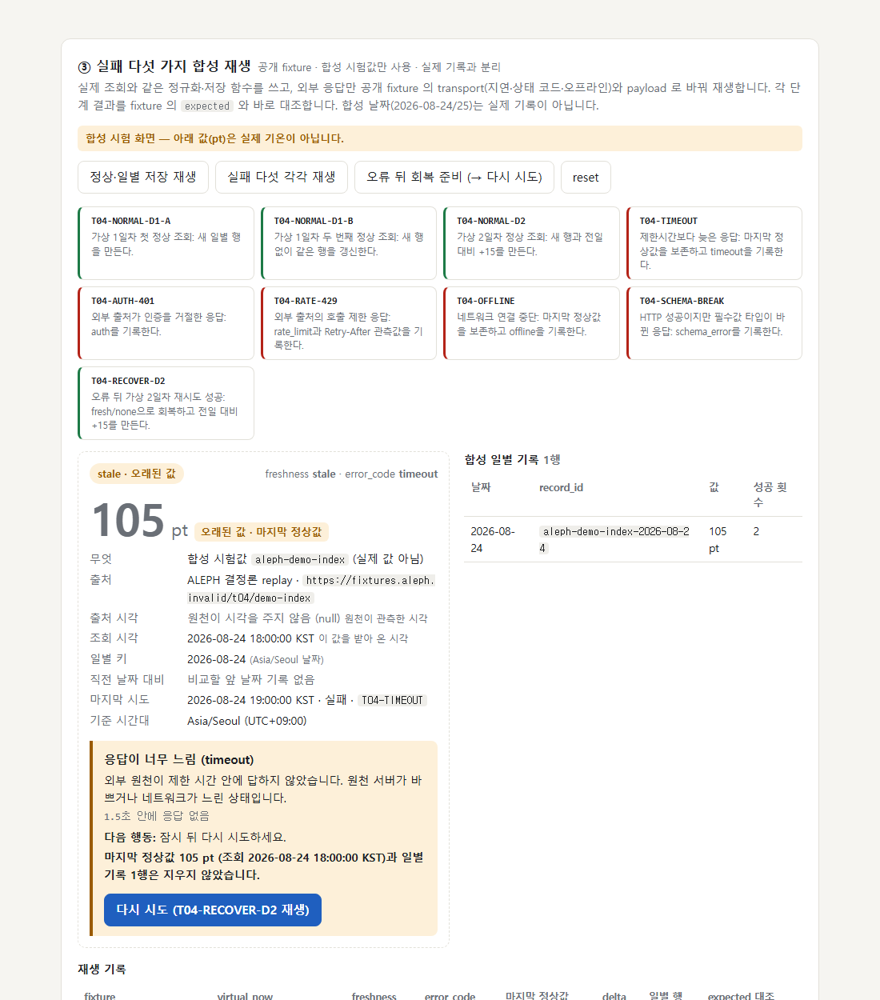
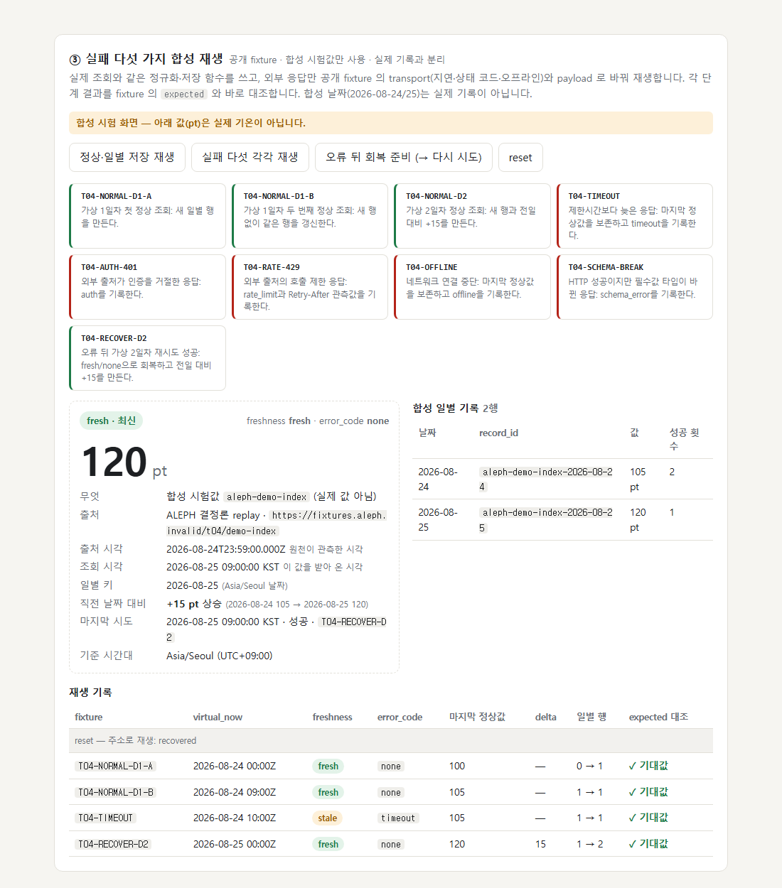
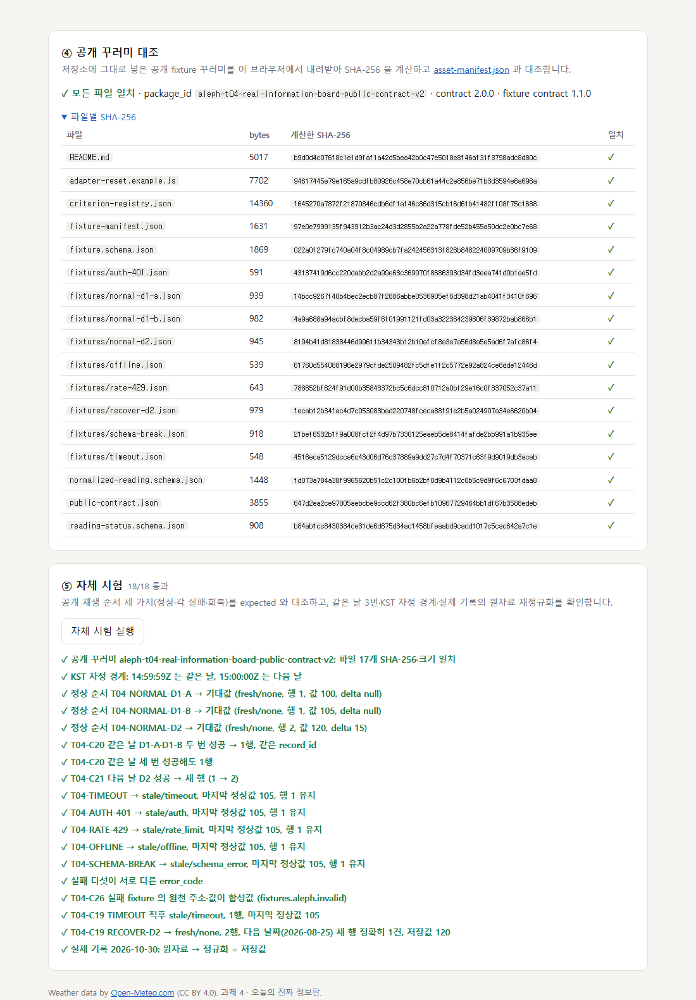

# 대전 기온 정보판 — 사용설명서

**바로 가기: https://lee-minsoo6944.github.io/t04-real-information-board/**
(로그인·회원가입 없이 누구나 열 수 있습니다)

대전 현재 기온을 매일 한 번 기록하고, 어제 값과 비교해 보여 주는 정보판입니다.
데이터가 늦거나 안 올 때도 **무슨 일이 생겼는지, 무엇을 하면 되는지, 마지막으로 정상이었던 값이 무엇인지**를 정직하게 보여 주는 것이 목표입니다. (과제 4 · 오늘의 진짜 정보판)

---

## 한눈에 보기

| 칸 | 무엇을 보여 주나요 | 사용자가 할 일 |
|---|---|---|
| ① 지금 값 | 지금 이 순간 대전 기온 (실제 조회) | 보기만 하면 됩니다. "새로 조회"로 다시 받아 올 수 있어요 |
| ② 일별 기록 | 하루 한 줄씩 쌓이는 실제 기록과 어제 대비 변화 | 각 줄의 "✓ 일치"를 확인 |
| ③ 실패 재생 | 데이터가 안 올 때 화면이 어떻게 바뀌는지 시험 | 버튼을 눌러 실패·회복을 재생 |
| ④ 공개 꾸러미 대조 | 과제용 시험 파일이 원본과 같은지 확인 | 보기만 하면 됩니다 |
| ⑤ 자체 시험 | 저장·실패·회복 규칙을 한 번에 검사 | "자체 시험 실행" 클릭 |

---

## ① 지금 값 · ② 일별 기록

**① 지금 값**은 페이지를 열 때마다 [Open-Meteo](https://open-meteo.com/) 공개 API에서 대전광역시청 부근 기온을 바로 받아 옵니다. 비밀키나 로그인이 필요 없는 공개 데이터입니다.

| 항목 | 뜻 |
|---|---|
| 큰 숫자 + °C | 기온 값과 단위 |
| fresh · 최신 / stale · 오래된 값 | 방금 받은 값인지, 받아 오기에 실패해 예전 값을 보여 주는 중인지 |
| 출처 | 값을 받아 온 곳 (누르면 원본 응답이 열립니다) |
| 출처 시각 | 기상 데이터가 관측된 시각 (15분 단위) |
| 조회 시각 | 이 페이지가 값을 받아 온 시각 |
| 일별 키 | 이 값이 속한 날짜 (한국 시간 기준) |
| 기준 시간대 | Asia/Seoul (UTC+09:00) — 모든 날짜는 한국 시간으로 나눕니다 |

**② 일별 기록**은 GitHub가 매일 오전 9시(KST)에 자동으로 값을 받아 저장한 실제 기록입니다.

- 한 날짜에는 **한 줄만** 남습니다. 같은 날 다시 받아 오면 새 줄을 만들지 않고 그 날짜 줄을 고칩니다.
- 각 줄은 **원자료 값 · 저장값 · 화면값**을 나란히 보여 주고, 페이지가 원본 응답을 다시 읽어 셋이 같으면 **✓ 일치**를 표시합니다.
- 기록이 두 날짜 이상 쌓이면 아래에 **어제 대비 변화**(예: `+1.3 °C 상승`)와 계산식이 나옵니다. 기록이 하나뿐이면 "두 번째 실제 날짜 기록을 기다리는 중"이라고 솔직하게 표시합니다.
- "날짜별 기록 값"을 펼치면 날짜마다 `source_url · source_observed_at · normalized_value · unit` 네 값을 그대로 복사할 수 있습니다.

---

## ③ 데이터가 안 올 때 — 실패 다섯 가지 재생

외부 데이터는 언제든 늦거나 막힐 수 있습니다. ③ 칸에서는 과제에서 제공한 **합성 시험 파일**로 다섯 가지 실패를 그대로 재현해 볼 수 있습니다. 이 칸의 값(pt)은 실제 기온이 아니고, 실제 기록과 섞이지 않습니다.

| 실패 | 화면에 나오는 이름 | 안내하는 다음 행동 |
|---|---|---|
| 응답이 너무 느림 | timeout | 잠시 뒤 다시 시도 |
| 외부 원천이 거절 (401/403) | auth | 원천의 이용 조건 확인 |
| 너무 자주 호출함 (429) | rate_limit | 안내된 시간(예: 60초) 뒤 다시 시도 |
| 인터넷 끊김 | offline | 연결 확인 후 다시 시도 |
| 응답 형식이 바뀜 | schema_error | 코드 수정 필요 |

실패해도 **마지막 정상값은 지우지 않고** 회색 숫자와 "오래된 값 · 마지막 정상값" 표시로 남겨 둡니다. 일별 기록도 그대로입니다.

### 버튼 사용법

| 버튼 | 하는 일 |
|---|---|
| 정상·일별 저장 재생 | 같은 날 두 번 성공 → 1줄, 다음 날 성공 → 2줄, 변화 +15 |
| 실패 다섯 각각 재생 | 정상 두 번 뒤 실패를 하나씩, 다섯 번 따로 재생 |
| 오류 뒤 회복 준비 (→ 다시 시도) | 정상 두 번 뒤 timeout 까지 재생하고 멈춤 |
| fixture 이름 버튼 (T04-…) | 그 시험 파일 하나만 지금 상태에 이어서 재생 |
| reset | 합성 시험 상태만 비움 (실제 기록은 그대로) |

아래 "재생 기록" 표의 마지막 칸은 각 단계 결과가 시험 파일에 적힌 기대값과 같은지(**✓ 기대값**) 보여 줍니다.

### 다시 시도로 회복하기

"오류 뒤 회복 준비"를 누르면 timeout 상태에서 멈추고 **다시 시도** 버튼이 나옵니다.

**다시 시도**를 누르면 다음 날 정상 응답(T04-RECOVER-D2)이 재생되어 `fresh / none` 으로 돌아오고, 다음 날짜 줄이 정확히 하나 추가됩니다.

---

## ④ 공개 꾸러미 대조 · ⑤ 자체 시험

- **④**: 저장소에 넣어 둔 과제 공개 꾸러미(`aleph-t04-real-information-board-public-contract-v2`) 17개 파일의 SHA-256 을 브라우저가 직접 계산해 목록과 비교합니다. 모두 같으면 "✓ 모든 파일 일치".
- **⑤**: "자체 시험 실행"을 누르면 같은 날 중복 방지, 한국 시간 자정 경계, 실패 다섯, 회복, 실제 기록 원자료 대조를 한 번에 검사합니다.

---

## 주소로 바로 보기

아래 주소를 열면 해당 상태를 자동으로 재생합니다.

| 보고 싶은 것 | 주소 끝에 붙이기 |
|---|---|
| 정상·일별 저장 | `?replay=normal` |
| 실패 다섯 전부 | `?replay=failures` |
| 특정 실패 하나 | `?replay=T04-RATE-429` (다른 이름도 가능) |
| 다시 시도 직전 | `?replay=recover` |
| 회복 후 | `?replay=recovered` |
| 자체 시험 자동 실행 | `?selftest=1` |

예: https://lee-minsoo6944.github.io/t04-real-information-board/?replay=recover

---

## 이 화면이 지키는 약속

- 비밀키·로그인·개인정보를 쓰지 않습니다.
- 출처 시각과 조회 시각을 따로 보여 줍니다.
- 실패해도 마지막 정상값과 일별 기록을 지우지 않고 "오래된 값"으로 표시합니다.
- 어제 대비 변화는 저장된 두 값으로 다시 계산합니다: `현재 − 이전`, 하루 차이일 때만 "어제 대비"라고 씁니다.
- 두 번째 날 기록이 없으면 기다립니다. 비교를 만들려고 기록을 꾸며 넣지 않습니다.

---

## 만든 사람을 위한 메모

구조와 규칙 펼치기

| 파일 | 하는 일 |
|---|---|
| `index.html`, `src/app.js` | 화면 (정적 페이지, 빌드 없음) |
| `src/core.js` | 정규화·형식 검사·실패 분류·한국 날짜·일별 저장·변화 계산 (브라우저와 기록 봇 공용) |
| `src/adapter.js` | 실제 조회와 합성 재생이 같은 저장 경로를 탄다 |
| `src/package.js` | 공개 꾸러미 읽기 + SHA-256 대조 |
| `src/selftest.js` | 자체 시험 |
| `scripts/record-daily.mjs` | 실제 원천 조회 → `data/daily.json`, `data/raw/<날짜>.json` |
| `.github/workflows/daily.yml` | 매일 09:00 KST 에 기록 봇 실행 후 커밋 (Actions 탭에서 수동 실행 가능) |
| `assets/t04-real-information-board-public-v1/` | 과제 공개 꾸러미 (바이트 그대로) |

- 원천: `https://api.open-meteo.com/v1/forecast?latitude=36.3504&longitude=127.3845&current=temperature_2m&timezone=Asia%2FSeoul`
- `signal_id = daejeon-temperature-2m`, 일별 고유키 = `signal_id + record_date`, `record_date` = 조회 시각의 Asia/Seoul 날짜
- 상태: `fresh / none` 또는 `stale / {timeout, auth, rate_limit, offline, schema_error}`
- 변화: 같은 signal 의 바로 앞 날짜 줄과 비교, 방향 + 크기 `|현재 − 이전|` (부동소수점 오차만 제거)
- 처음에는 서울 기온으로 시작했다가 2026-10-30 에 대전 기온으로 바꿨습니다. 서울 기록 1건은 Git 기록에만 남아 있습니다.
- 비밀값 검사: `git grep -n -i -E "api[_-]?key|secret|token|password|bearer|authorization" $(git rev-list --all)`

데이터: Weather data by [Open-Meteo.com](https://open-meteo.com/) (CC BY 4.0)
